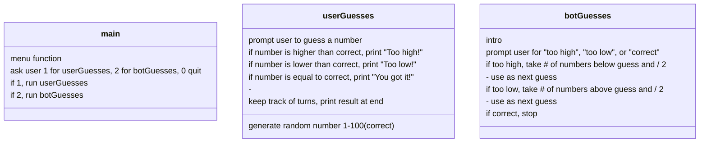

# javaGuesser

## Bot Guesses

- Make ints high and low, default to 100 and 0 respectively
- First guess sum of high and low divided by 2 (50)
- If computer's guess is too high, make 50 the high
- Again, sum of high and low divided by 2, repeat till correct
- Do the same thing but reversed if number is too low (make 50 the low)
- Turn count++ 
